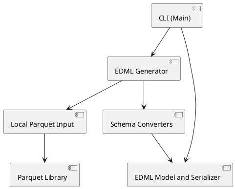

# Building Block View

This chapter describes the static decomposition of the system into building blocks and responsibilities.

## Component Overview

The application is a single-process Java command-line program.

## Component Design Items

### CLI Entry Point
`dsn~cli-entry-point~1`

`Main` accepts the input path, calls the generator, serializes the definition, and writes it to standard output.

Status: draft

Covers:
- `scn~generate-definition-from-file~1`

Needs: impl

### Parquet Schema Mapping Components

`ParquetEdmlGenerator` reads the file schema and delegates field conversion to converters. The column converter recursively maps group fields and delegates annotated logical types to the logical type converter. The runtime design items define the separate primitive, logical, nested-structure, and name-normalization behaviors.
