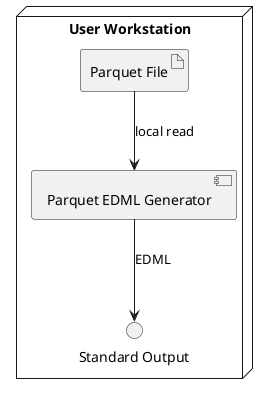

# Deployment View

This chapter describes how the system is packaged and deployed in its execution environment.

## Deployment Environment

Users download a release artifact and execute it locally. Self-contained native executables are available for Linux and Windows. Alternatively, users can run the Java JAR with Java 21 or higher.

## Runtime Nodes

* User workstation
* Local file system containing the Parquet file
* CLI process (JAR or native executable)

## Deployment Diagram

## Deployment Strategy

CI builds native images for Windows and Linux, and Maven also assembles a JAR.

Users should download the latest release.
